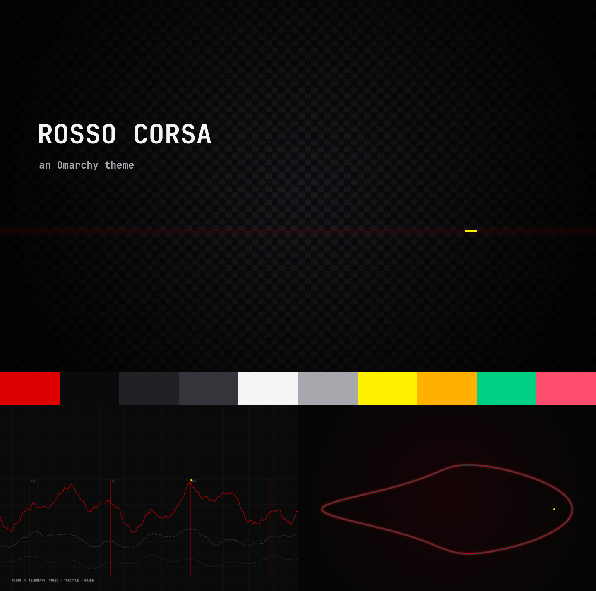

# Rosso Corsa — an Omarchy theme

A dark racing theme for [Omarchy](https://omarchy.org): carbon-black surfaces, graphite panels,
telemetry-white text and a single racing red accent, with a touch of helmet yellow for highlights.



## Install

```bash
omarchy theme install https://github.com/Manideep-Ai-ai/omarchy-rosso-corsa-theme.git
```

Or from the Omarchy menu: **Install → Style → Theme**, then paste the URL above.

The theme appears as **rosso-corsa**. Switch to it any time with:

```bash
omarchy theme set rosso-corsa
```

## What's included

| File | What it styles |
|---|---|
| `colors.toml` | Terminal, bar, menus and every app Omarchy themes from the palette |
| `hyprland.lua` | Red gradient focus border, graphite inactive border, short slide for workspaces |
| `btop.theme` | Pit-wall style system monitor |
| `icons.theme` | Yaru-red icon set |
| `chromium.theme` | Browser toolbar color |
| `neovim.lua`, `vscode.json` | Matte Black editor themes to sit on the carbon background |
| `backgrounds/` | Three wallpapers: carbon with red light strip, telemetry traces, night circuit |

Cycle wallpapers with `omarchy theme bg next`.

## Palette

| Role | Color |
|---|---|
| Accent | `#DC0000` |
| Background | `#0A0A0A` |
| Raised surface | `#202025` |
| Selection / border | `#34343A` |
| Text | `#F5F5F5` |
| Secondary text | `#A7A7AD` |
| Highlight | `#FFF200` |
| Warning | `#FFB000` |
| Success | `#00D084` |

## License

MIT. This is an independent fan theme and is not affiliated with or endorsed by any racing team or brand.
